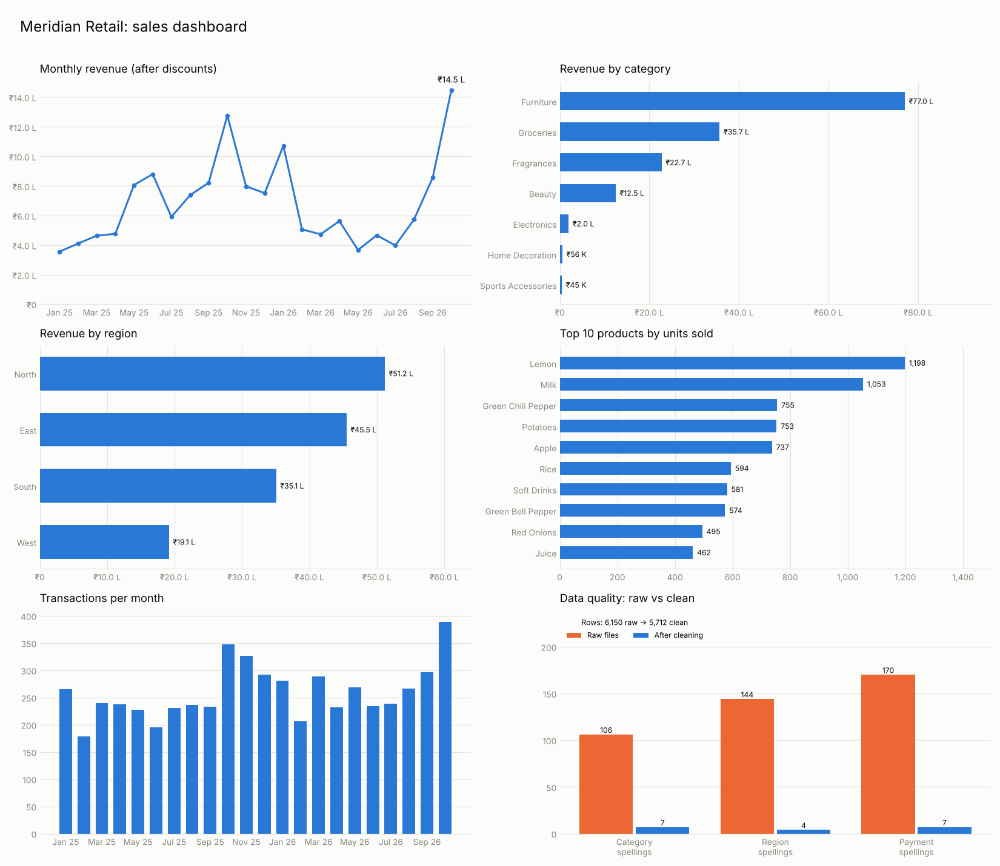
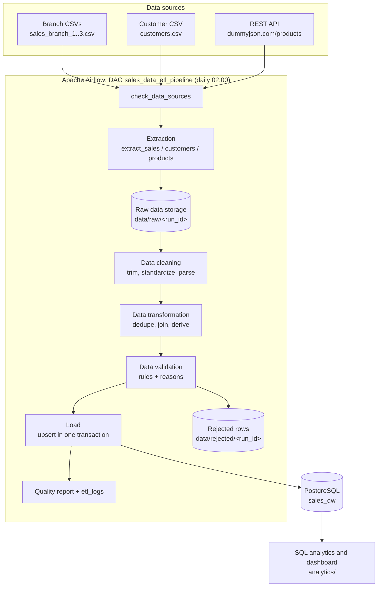
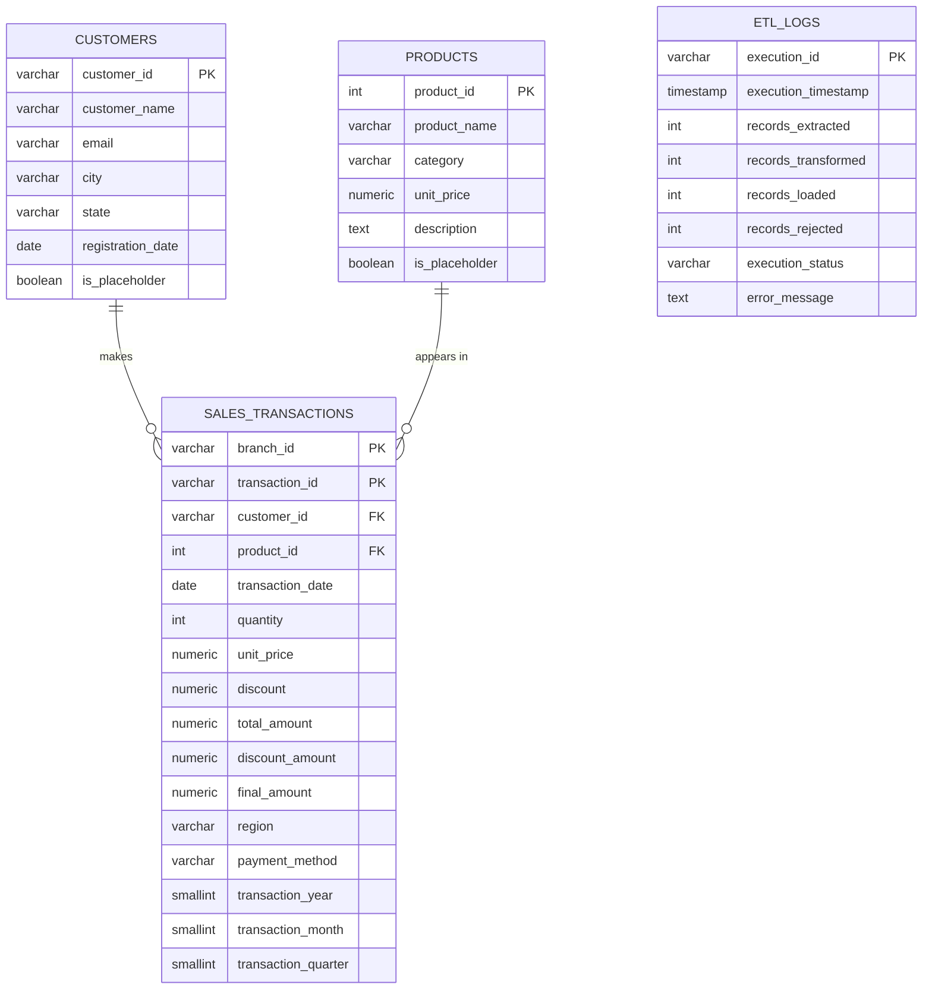

# End-to-End ETL Pipeline for Multi-Source Sales Data Integration and Analytics

**Python · Pandas · PostgreSQL · SQLAlchemy · Apache Airflow 3 · Docker**

An automated pipeline that collects sales data for a fictional retail chain from three branch CSV files, a customer CSV file and a public product REST API; cleans, validates and integrates it; loads it into a PostgreSQL warehouse with an idempotent upsert; and runs every day under Apache Airflow. SQL analytics and a Matplotlib dashboard sit on top.



---

## 1. Business problem

**Meridian Retail** (fictional) sells groceries, beauty, fragrance and furniture products through three branches. Each branch exports its sales differently:

| File | Branch | Date format | Discount written as | Typical problems |
|---|---|---|---|---|
| `sales_branch_1.csv` | East (Patna) | `05-03-2025` (DD-MM-YYYY) | `0.10` | extra spaces, `E` / `Eastern` |
| `sales_branch_2.csv` | North (Delhi) | `2025-03-05` (YYYY-MM-DD) | `10` (percent) | `₹1,099.50` prices, `paytm wallet` |
| `sales_branch_3.csv` | South (Bengaluru) | `03/05/2025` (MM/DD/YYYY) | `0.1` | `CC`, `U.P.I`, missing IDs |

Head office used to merge these by hand in Excel. That was slow, error prone and impossible to audit. This pipeline does it automatically, with written rules, and keeps every rejected row with the reason it was rejected.

## 2. Objectives

1. Extract data from at least three different sources (CSV files, customer CSV, REST API).
2. Clean, standardize, validate and integrate it with documented rules.
3. Store it in a properly designed relational database (primary keys, foreign keys, indexes).
4. Make the load **idempotent**: running it again never creates duplicates.
5. Orchestrate the steps with Airflow on a daily schedule with retries, timeouts and logging.
6. Measure data quality on every run and keep rejected rows for investigation.
7. Prove the data is useful with SQL analytics and charts.

## 3. Technology stack

| Tool | Role in this project |
|---|---|
| Python 3.12 | All pipeline code |
| Pandas / NumPy | Cleaning, transforming, joining |
| Requests | Calling the REST API (with retries, timeouts, pagination) |
| PostgreSQL 16 | The data warehouse (`sales_dw`) |
| SQLAlchemy 2 | Database connections and transactions |
| Apache Airflow 3.3 | Scheduling and orchestration (LocalExecutor) |
| Docker Desktop + Compose | Runs PostgreSQL and Airflow the same way on every machine |
| pytest | Unit, integration and end-to-end tests |
| Matplotlib | Dashboard charts |
| [DummyJSON](https://dummyjson.com) | Free product API, no key needed (`/products`) |

## 4. Architecture



### Why a raw copy is kept

Every run saves an untouched copy of the input in `data/raw/<run_id>/`. If a bug is found in the cleaning code next month, you fix it and re-run the transform from the raw copy, without asking the branches for their files again. Raw, processed and rejected data each have their own folder, so you always know which version you are looking at.

## 5. Workflow (what each step does)

| Airflow task | Code | What happens |
|---|---|---|
| `check_data_sources` | `src/extraction/check_sources.py` | All 4 CSV files exist, are readable and have the right columns. API reachable? If not, the saved snapshot will be used. |
| `extract_sales_data` | `src/extraction/extract_csv.py` | Reads the 3 branch files **as text**, adds `branch_id`, `source_file`, `source_row_number`, saves `sales_raw.csv`. |
| `extract_customer_data` | `src/extraction/extract_customers.py` | Reads `customers.csv`, saves a raw copy. |
| `extract_product_data` | `src/extraction/extract_api.py` | Pages through `GET /products?limit=50&skip=N`, validates the JSON, falls back to `data/reference/products_snapshot.json` if the API fails. |
| `transform_and_validate_data` | `src/transformation/` | Clean → remove duplicates → validate → join → derive columns. Writes processed and rejected files plus metrics. |
| `load_data_into_postgresql` | `src/loading/` | Creates tables if needed, then upserts customers, products and sales in **one** transaction. |
| `generate_data_quality_report` | `src/monitoring/quality_report.py` | Writes `reports/<run_id>/data_quality_report.md` and `.json`. Runs even if the load failed. |
| `log_pipeline_execution` | `src/pipeline.py` | Writes one row into `etl_logs` (SUCCESS or FAILED with the error). Always runs. |

### Cleaning and validation rules

| Problem | Rule | Why |
|---|---|---|
| Missing `customer_id` | Assign placeholder customer `UNKNOWN`; keep the sale | The money was really received; revenue must not disappear |
| `customer_id` not in customers.csv | Keep the sale; create a placeholder customer row; count it | Same reason; the FK still holds and the gap is reported |
| Malformed `customer_id` (`CUST-??`) | Reject | Cannot be trusted or fixed |
| Missing `product_name` | Take the name from the API | The API is the product master |
| Product not in the API | Keep the sale; placeholder product built from the CSV name/category | Nothing silently lost |
| Missing/invalid `product_id` | Reject | We would not know what was sold |
| Different date formats | Parse with the branch's own format, then safe fallbacks (`05 Mar 2025`) | We never guess between DD/MM and MM/DD |
| Impossible date (`31-02-2025`, `N/A`) or future date | Reject | |
| Negative, zero or text quantity | Reject | |
| Zero, negative or text price | Reject; `₹1,099.50` is cleaned to `1099.50` | |
| Discount | Stored as a **decimal fraction 0 ≤ d < 1** (`0.10` = 10%). `10` from Branch 2 becomes `0.10`. Missing becomes `0`. `150` is rejected | One convention everywhere |
| Category / region / payment spellings | Mapped to one canonical value (`smart phones` → `Smartphones`, `E` → `East`, `gpay` → `UPI`) | |
| Missing region / payment | Branch's home region / `Unknown` | Non-critical fields |
| Extra spaces | Trimmed and collapsed in every text column | |
| Exact duplicate rows | Removed (listed in `duplicate_sales_removed.csv`) | Same sale exported twice |
| Same branch + transaction ID, different values | First kept, others rejected for review | We cannot know which one is right |
| Same transaction ID in **different** branches | Kept | Each branch numbers its own sales, so the key is `(branch_id, transaction_id)` |
| Customer file duplicates | Exact copies removed; same ID with new details keeps the **last** row | Latest record is the most recent update |
| Invalid email (`ravi@`) | Set to empty | Non-critical |

Derived columns: `total_amount = quantity × unit_price`, `discount_amount = total_amount × discount`, `final_amount = total_amount − discount_amount`, plus `transaction_year`, `transaction_month`, `transaction_quarter`. Amounts are in INR; DummyJSON prices (USD) are converted with `API_PRICE_TO_INR` (default 85).

## 6. Database schema



* One customer has many sales, one product appears in many sales (one-to-many relationships through foreign keys).
* `CHECK` constraints make the database itself refuse bad values (quantity ≤ 0, discount ≥ 1, unknown status).
* Indexes on `customer_id`, `product_id`, `transaction_date`, `region` and `category` keep joins and filters fast.
* Full definition: [`sql/create_tables.sql`](sql/create_tables.sql).

### How duplicates are prevented (idempotency)

```sql
INSERT INTO sales_transactions (branch_id, transaction_id, ...) VALUES (...)
ON CONFLICT (branch_id, transaction_id) DO UPDATE SET quantity = EXCLUDED.quantity, ...
```

If the key already exists, the row is updated instead of inserted. All three tables are written inside one transaction, so a failure half way leaves the database exactly as it was.

## 7. Project structure

```
etl-sales-pipeline/
├── dags/sales_etl_dag.py          Airflow DAG (orchestration only)
├── src/
│   ├── pipeline.py                every step as a function + command line runner
│   ├── exceptions.py              custom error types
│   ├── extraction/                check_sources, extract_csv, extract_customers, extract_api
│   ├── transformation/            clean_data, validate_data, transform_data
│   ├── loading/                   database (engine, tables), load_data (upsert, etl_logs)
│   └── monitoring/                logger, quality_report
├── config/config.py               all settings (read from environment / .env)
├── sql/create_tables.sql          database schema
├── scripts/
│   ├── generate_data.py           creates the messy sample dataset
│   └── mock_api.py                local copy of the product API (no internet needed)
├── analytics/                     queries.sql, run_queries.py, dashboard.py
├── tests/                         pytest suite (67 tests)
├── data/
│   ├── source/                    incoming files (the "landing zone")
│   ├── reference/                 products_snapshot.json (API fallback)
│   ├── raw/ processed/ rejected/  one sub-folder per run
├── reports/                       data quality report per run
├── logs/                          pipeline.log and Airflow task logs
├── docker/                        Airflow Dockerfile, PostgreSQL init script
├── docs/                          Windows setup, troubleshooting, learning guide, images
├── docker-compose.yml  .env.example  requirements.txt  pytest.ini
```

## 8. Installation (Windows)

Full beginner walkthrough with screenshots to expect: **[docs/WINDOWS_SETUP.md](docs/WINDOWS_SETUP.md)**. Short version, in PowerShell:

```powershell
# 0. One time: WSL2 + Docker Desktop installed and running (see WINDOWS_SETUP.md)
cd "D:\projects\etl-sales-pipeline"

# 1. Python environment
python -m venv .venv
.\.venv\Scripts\Activate.ps1
python -m pip install --upgrade pip
pip install -r requirements.txt

# 2. Secrets
copy .env.example .env      # then open .env and change the passwords

# 3. Database only (enough for running the pipeline without Airflow)
docker compose up -d postgres
```

## 9. Running the pipeline

```powershell
python scripts\generate_data.py          # create the sample data (already included)
python -m src.pipeline                   # run every step once
python -m src.pipeline                   # run again: 0 new rows (idempotent)
```

Expected end of the output:

```json
{
  "execution_id": "cli_20261107T101500",
  "records_extracted": 6150,
  "records_transformed": 5712,
  "records_loaded": 5712,
  "records_rejected": 318,
  "execution_status": "SUCCESS"
}
```

Then look at `reports\<run_id>\data_quality_report.md` and `data\rejected\<run_id>\rejected_sales.csv`.

Scaling up: `python scripts\generate_data.py --rows-per-branch 100000 --customers 20000` creates about 300,000 sales rows. The loader already works in batches of 1,000 rows.

No internet? Run `python scripts\mock_api.py` in a second terminal and set `API_BASE_URL=http://localhost:8000` in `.env`. Or do nothing: the pipeline falls back to the saved snapshot automatically.

## 10. Airflow setup and scheduling

```powershell
docker compose up -d --build        # first time: 5 to 10 minutes (downloads and builds images)
docker compose ps                   # all services "healthy"; airflow-init "exited (0)"
```

1. Open **http://localhost:8080**, log in with `AIRFLOW_ADMIN_USER` / `AIRFLOW_ADMIN_PASSWORD` from `.env`.
2. Find `sales_data_etl_pipeline`, switch the toggle **on** (DAGs start paused).
3. Click **Trigger** to run now. Otherwise it runs every day at **02:00 IST** (`schedule="0 2 * * *"`).
4. Open the run → **Graph** view to watch tasks turn green, click a task → **Logs** for its log.

| Setting | Value | Where |
|---|---|---|
| Start date | 2026-11-01 (Asia/Kolkata) | `start_date` |
| Schedule | daily 02:00 | `schedule` |
| Catch-up | off (no back-filling old days) | `catchup=False` |
| Retries | 2, starting after 2 min, exponential backoff, max 10 min | `default_args` |
| Task timeout | 15 minutes | `execution_timeout` |
| Run timeout | 1 hour | `dagrun_timeout` |
| Parallel runs | 1 | `max_active_runs` |
| Failure handling | `on_failure_callback`; report and log tasks use `trigger_rule="all_done"` | |
| History | Airflow UI (Grid view) + the `etl_logs` table | |

Useful commands:

```powershell
docker compose exec airflow-scheduler airflow dags list-import-errors
docker compose exec airflow-scheduler airflow dags test sales_data_etl_pipeline
docker compose logs -f airflow-scheduler
docker compose down          # stop (data is kept)
```

**Application logs vs Airflow task logs.** Our own messages are written by `src/monitoring/logger.py` to `logs/pipeline.log` (and the console). When the code runs inside Airflow, the same messages also appear in Airflow's task logs (UI → task → Logs, stored in `logs/airflow/`). Airflow additionally logs task start/end, retries and exit codes, which our code never sees.

## 11. Sample SQL analytics

14 queries in [`analytics/queries.sql`](analytics/queries.sql): total revenue, monthly revenue, top 10 products, revenue by category, sales by region, average transaction value, most active customers, monthly volume, payment methods, highest revenue category, month-over-month growth (`LAG`), quarterly revenue by branch, revenue by state, pipeline run history.

```powershell
python -m analytics.run_queries                       # all queries, also saved as CSV
python -m analytics.run_queries --query top_10_products
python -m analytics.dashboard                         # PNG charts in analytics\output\
```

Example (revenue by category, with each category's share):

```sql
SELECT p.category,
       ROUND(SUM(s.final_amount), 2) AS revenue,
       ROUND(100.0 * SUM(s.final_amount) / SUM(SUM(s.final_amount)) OVER (), 2) AS revenue_share_pct
FROM sales_transactions AS s
JOIN products AS p ON p.product_id = s.product_id
GROUP BY p.category
ORDER BY revenue DESC;
```

## 12. Testing

```powershell
pytest                    # 67 tests; database tests use a temporary SQLite file
pytest -v tests\test_transformation.py
```

| File | Covers |
|---|---|
| `test_extraction.py` | CSV reading, missing/empty/corrupted files, API pagination, timeouts, bad JSON, HTTP errors, snapshot fallback, the local mock API over real HTTP |
| `test_transformation.py` | Missing values, duplicates (exact, conflicting, cross-branch), date formats, standardization, validation reasons, joins, derived columns, row accounting |
| `test_loading.py` | Inserts, upserts, idempotency, rollback on failure, `etl_logs` |
| `test_end_to_end.py` | Generate → full pipeline twice → no duplicates → every analytics query; failure gets logged |
| `test_dag.py` | DAG structure; with Airflow installed also imports it with `DagBag` |

To run the database tests against PostgreSQL instead of SQLite, create an empty database `sales_dw_test` and set `TEST_DATABASE_URL=postgresql+psycopg2://etl_user:<password>@localhost:5432/sales_dw_test`.

How to read the result: `.` = passed, `F` = failed (pytest prints the exact assertion), `s` = skipped (for example the Airflow test when Airflow is not installed on Windows).

## 13. Screenshots to capture for GitHub

Save them in `docs/images/` and link them here:

1. Airflow **DAGs list** with `sales_data_etl_pipeline` switched on.
2. Airflow **Graph view** of a successful run (all 8 tasks green).
3. Airflow **Grid view** showing several daily runs (execution history).
4. A task's **Log** page (e.g. `transform_and_validate_data`).
5. A **failed then retried** task (rename `customers.csv`, trigger, then restore it).
6. **pgAdmin / psql** showing the four tables and a query result.
7. `etl_logs` table contents.
8. `data_quality_report.md` opened in VS Code preview.
9. A few rows of `rejected_sales.csv` with the `rejection_reason` column.
10. `pytest` output with all tests passing.
11. `docker compose ps` with every service healthy.
12. The dashboard PNG (already in `docs/images/dashboard.png`).

## 14. Future improvements

* Incremental loads (only new files, tracked by a watermark) instead of re-reading every file.
* Store raw files as Parquet and in cloud storage (S3 / Azure Blob).
* Data quality framework (Great Expectations or Soda) and alerts by e-mail or Slack on failure.
* dbt for the SQL transformation layer and a proper star schema (date dimension, branch dimension).
* Separate least-privilege database user for the ETL (currently it shares the Postgres admin user).
* CI with GitHub Actions running `pytest` on every push.
* Slowly changing dimension (history) for customers who move city.
* An interactive dashboard (Metabase or Streamlit) instead of static PNGs.

---

*Data is synthetic and the company is fictional. Product data comes from the free DummyJSON API.*
